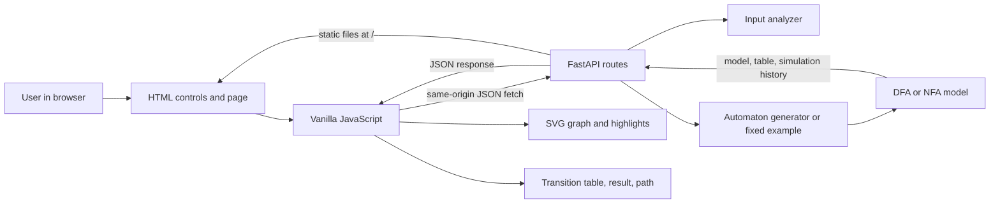
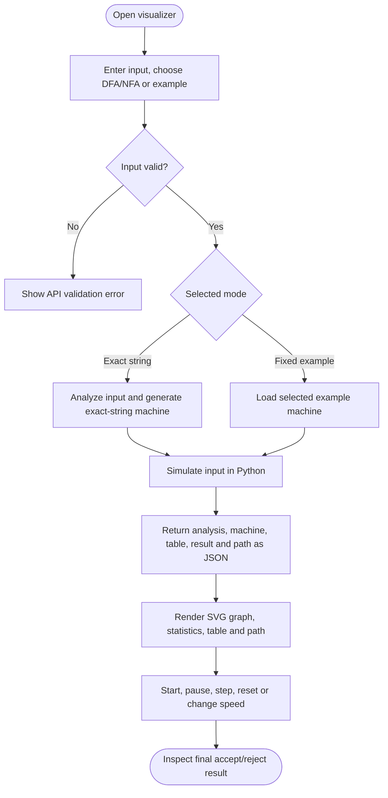
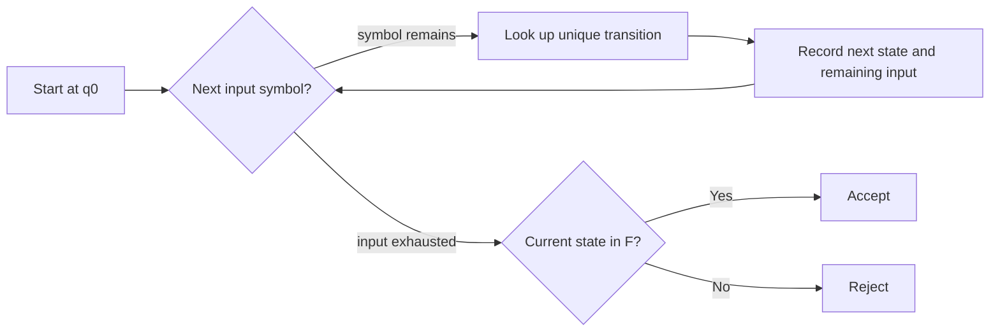

# Project Architecture and Methodology

## System architecture



FastAPI serves both the JSON endpoints and the static frontend from `frontend/`, so browser requests use the same origin. The frontend consumes actual simulation history returned by the backend; animation moves the display through that history.

## Project flow



## Modules and responsibilities

| Module/file | Responsibility |
|---|---|
| `backend/main.py` | Defines FastAPI and Pydantic request schemas; validates route parameters; invokes analyzer, generator and simulation; serves static UI. |
| `backend/services/analyzer.py` | Enforces the 100-character limit and returns input length, distinct alphabet, and unique-symbol count. |
| `backend/services/generator.py` | Constructs exact-string DFA/NFA models and provides the simple DFA, substring NFA, and branching NFA demonstrations. |
| `backend/models/automaton.py` | Common machine data, transition serialization, and transition table. |
| `backend/models/dfa.py` | One-state deterministic simulation and per-character history. |
| `backend/models/nfa.py` | Set-of-active-states simulation and per-character history. |
| `frontend/index.html` | Input, machine/example selections, playback controls, diagram, table, path, and theory containers. |
| `frontend/js/app.js` | Calls API, renders response, constructs SVG graph, highlights active states/edges, manages playback. |
| `frontend/css/style.css` | Cards, responsive grid, table, path, graph, animation highlight and status styling. |
| `backend/tests/test_automata.py` | Focused behavioral tests for exact construction, examples and input analysis. |

## Input-to-output interaction

1. On page load, JavaScript checks `GET /api/health` and submits the default input using the exact-string simulation endpoint.
2. The user may edit the string, choose a machine type, and choose the exact-string mode or a built-in example.
3. For exact mode the browser sends `POST /api/simulate/dfa` or `/api/simulate/nfa` with a JSON `input`. For a built-in example it sends `POST /api/example` with the example ID and input.
4. FastAPI validates the route kind or example name, calls `analyze_string`, obtains the machine, and runs its Python `simulate` method. Inputs over the supported length and unknown route choices produce an error response.
5. The returned JSON contains analysis, automaton serialization, transition table, and computation result/history.
6. JavaScript renders statistics, SVG states and transitions, transition table, path entries, and the final result. Playback controls select history indices; the browser does not recompute the machine's acceptance result.

## DFA processing workflow



For an exact-string DFA, generated transitions cover each state-symbol pair in the generated alphabet and route non-chain choices to `D`. Fixed DFA simulation rejects a symbol with no defined transition and reports it as invalid.

## NFA processing workflow

```mermaid
flowchart LR
  A[Active set = {q0}] --> B{Next input symbol?}
  B -->|symbol remains| C[Union targets from every active state]
  C --> D[Record new active set and traversed edges]
  D --> B
  B -->|input exhausted| E{Active set intersects F?}
  E -->|Yes| Y[Accept]
  E -->|No| N[Reject]
```

No epsilon-closure step is used because no epsilon transitions are implemented. An empty target union leaves an empty active set.

## Visualized response

The page uses an incoming arrow to mark the initial state, single or double circles for states, labeled directed edges for transitions, and `D` for the exact DFA's dead state. At a chosen computation step, the active states and traversed transition edges receive active styling. The transition table and textual path expose the same backend response for cross-checking.

The actual app was observed running at `http://127.0.0.1:8000/` on 26 November 2026, with input `101` and the exact-string NFA selected. The current source workspace does not include a screenshot image asset; capture and add one from the running UI before submitting if the course submission requires the image to travel with these Markdown files.

## Run locally

```powershell
python -m venv .venv
.\.venv\Scripts\Activate.ps1
python -m pip install -r requirements.txt
python -m uvicorn backend.main:app --reload
```

Then visit `http://127.0.0.1:8000/`. The active environment observed during review is recorded in [the technical documentation](PROJECT_DOCUMENTATION.md#3-technologies-tools-and-versions).
